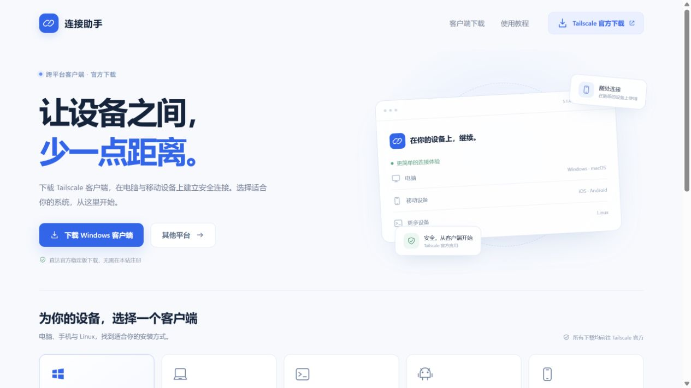
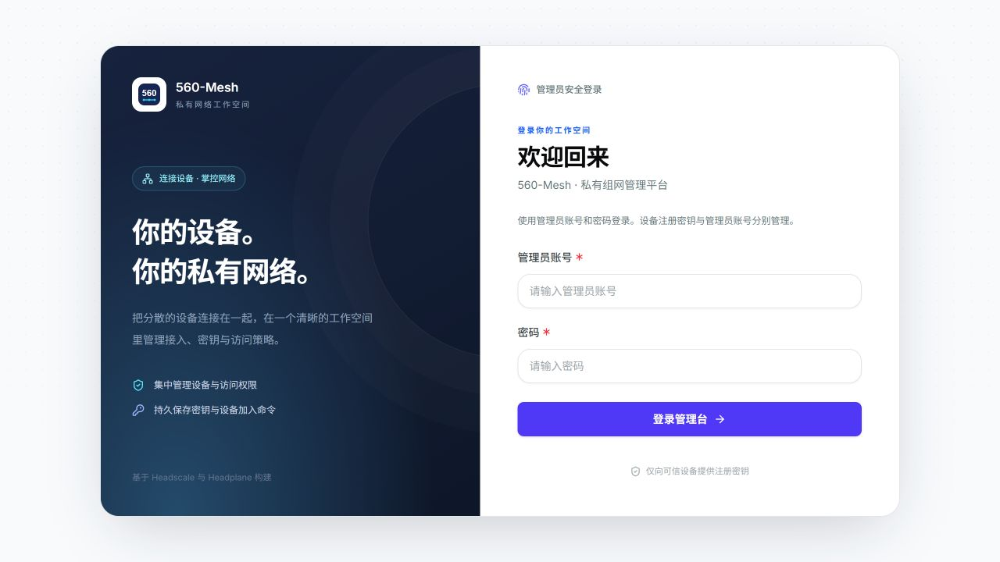
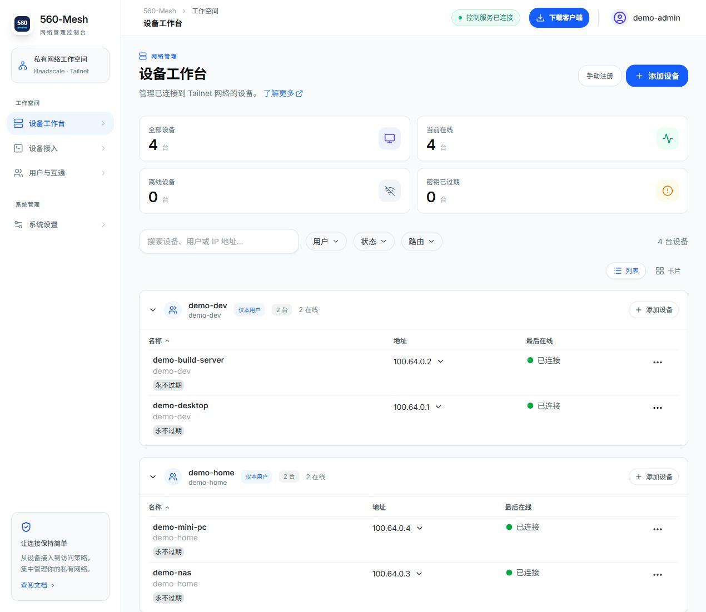
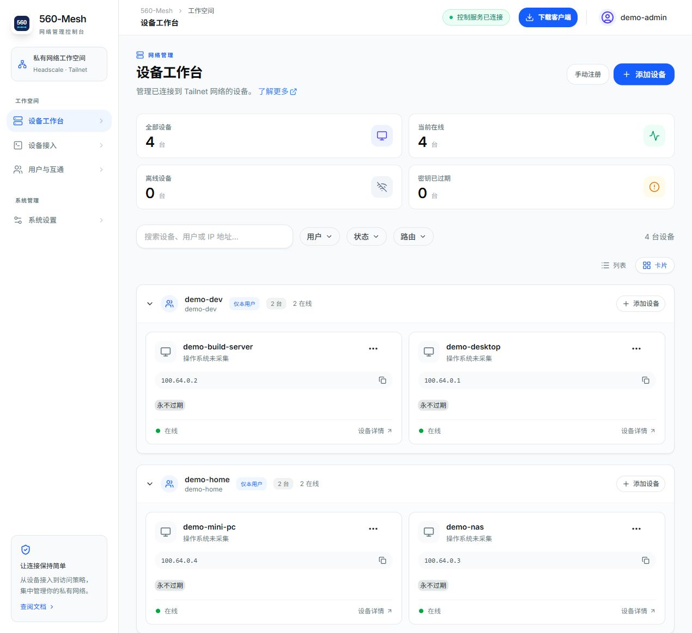
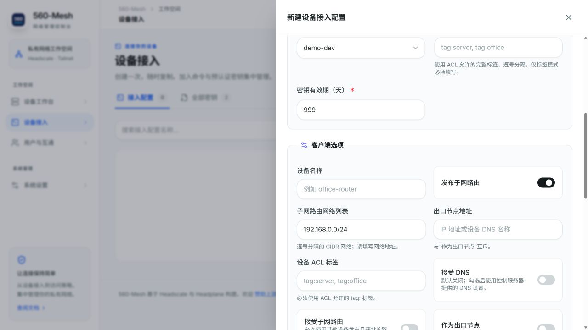
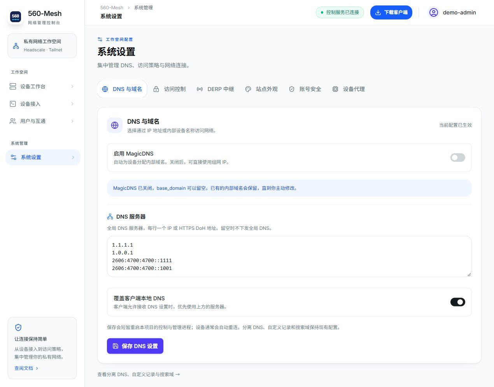
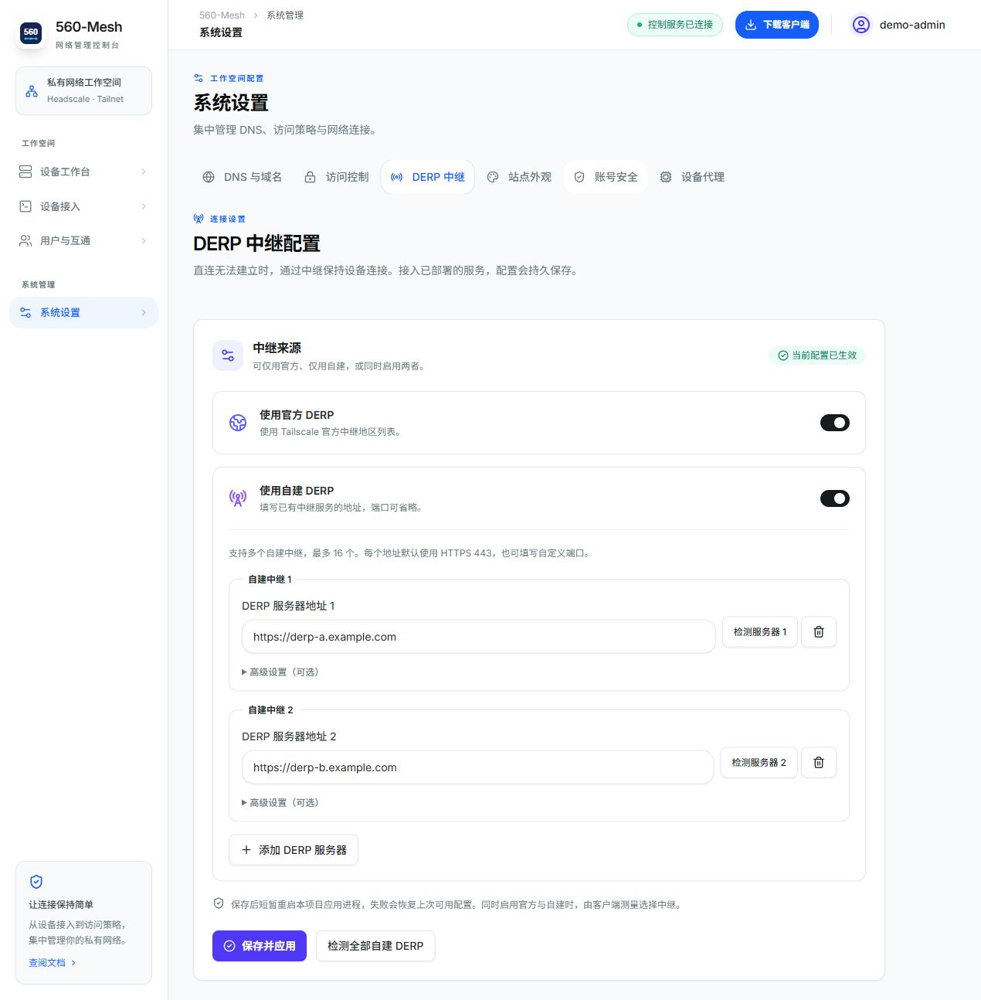

# 界面截图与隐私

截图来自独立的本地访问演示环境，运行当前560-Mesh源码。没有连接或截取生产管理台。

演示用户名为demo-dev、demo-home，管理员显示名demo-admin。demo-*设备与100.64.0.x地址由临时演示网络生成，不能用来识别实际部署用户。
DERP表单使用保留示例域名derp-a.example.com/derp-b.example.com，没有将其保存为有效中继。接入表单未保存，未展示可用认证密钥；源码中可能出现的REPLACE_AFTER_SAVE只是不可执行占位符。
没有将私钥、Cookie、管理员密码、API Key、数据库、真实域名或内网拓扑放入图片。浏览器地址栏不在截图中，底部服务器URL保持隐藏。
截图是直接浏览器截图，未伪造业务状态或在图片上拼接敏感内容。演示设备通过临时Tailscale客户端实际加入；操作系统尚未采集时界面如实显示未知。

## 公开首页

## 管理员登录

## 设备列表

## 设备卡片

## 接入表单

## DNS设置

## 多DERP配置

